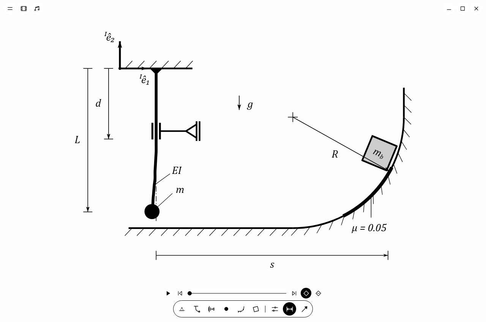

# Cynetic

Cynetic is a Windows app for drawing and animating mechanical systems. Place the parts, set their motion on a timeline, and export an MP4. The editor is written in Rust with an embedded, icon-only interface.

[Download Cynetic for Windows](https://github.com/hashk014/Cynetic/releases/latest/download/Cynetic.exe) · [Watch the example film](https://github.com/hashk014/Cynetic/releases/latest/download/Cantilever.mp4) · [Download the editable project](https://github.com/hashk014/Cynetic/releases/latest/download/Cantilever.cynetic)



## Recreate the example film

1. Open `Cynetic.exe` and press **Play**. The built-in project tracks a bob on the end of a flexible beam as it strikes a block on a curved rail. To reopen the example later, choose the **beam and bob** icon in the top-left menu.
2. Scrub to a frame and drag the bob, clamp, or block. Each drag sets a keyframe for that part. Cynetic interpolates between keyframes. Moving the support or rail changes its position throughout the film.
3. To try a different motion, select a part and open the **sliders**. Adjust its mass, the beam stiffness, or the initial angular kick. Click the **wave** to recalculate from the first frame. Use **Ctrl+Z** to recover the previous motion.
4. Toggle **dimensions** to show or hide mathematical annotations. Toggle the **arrow** to show velocity vectors for the bob and block. Each vector shows how far the part would travel in one tenth of a second at its estimated instantaneous velocity.
5. To add sound, click the **musical note** and pick an audio file or a local copy of the reference video. Select the track again if you reopen the project.
6. Press **Ctrl+S** to save the editable project. Click the **filmstrip** to export the video. The example exports directly at **3840 × 2160 (4K UHD), 60 fps**. Cynetic draws 920 frames over 15.33 seconds, sampling the original 30 Hz motion tracks at half-frame intervals. The 3:2 diagram is centered on a 16:9 sheet with matching margins on both sides.

The example stores the beam shape, clamp position, and block motion measured from the reference footage. Cynetic redraws each frame from that data. Recalculating uses a single bending mode, a prescribed clamp motion, and collisions between the bob and block. The marked section of the rail uses the friction coefficient shown in the diagram.

## Build a mechanism from scratch

Choose **+** from the top-left menu to open a blank sheet. Select a part from the bottom toolbar, then click the sheet to place it. The six parts are the support, beam, sliding clamp, bob, rail, and block. The bob follows the beam tip, and the block moves along the rail.

| Control | Action |
| --- | --- |
| Diamond / diamond with a minus | Add or remove a keyframe on the selected track |
| Snowflake in part settings | Freeze the selected track at its current pose |
| Trash can in part settings | Remove the selected part |
| Clock slider | Set the film length in frames |
| **Space** | Play or pause |
| **←** / **→** | Step back or forward one frame |
| **Ctrl+Z** / **Ctrl+Y** | Undo or redo |
| **Ctrl+Shift+S** | Save a copy |

The **wheel** icon in the menu opens the mechanics editor and the vertical **Saltos** example, which features a rolling disk, a double pendulum, and motion analysis tools. Portrait movies export at **2160 × 3840, 60 fps**, and portrait PNGs use the same resolution.

## Run on Windows

The interface uses Microsoft Edge WebView2. Video export requires FFmpeg on the Windows `PATH`, with the `libx264` H.264 encoder. If you need FFmpeg, install it with the following command, then restart Cynetic.

```powershell
winget install --id Gyan.FFmpeg -e
```

To render from PowerShell, put the downloaded executable and project in the same directory and run either command. The second example takes its soundtrack from a local video.

```powershell
.\Cynetic.exe --render-flex .\Cantilever.cynetic .\Film.mp4 | Out-Null
.\Cynetic.exe --render-flex .\Cantilever.cynetic .\Film-with-audio.mp4 "C:\Videos\reference.mp4" | Out-Null
```

## Build and test

On Windows x64, install stable Rust for MSVC, the Visual Studio C++ Build Tools, the Windows SDK, and Python 3. The build embeds the Python-based Saltos renderer in the executable.

```powershell
python -m pip install pyinstaller numpy pillow
cargo test --release --locked
cargo build --release --locked
.\target\release\Cynetic.exe
```

The UI smoke test starts with a blank sheet, places parts with the mouse, animates the bob, enables velocity vectors, and checks saving, undo, and redo.

```powershell
python -m pip install playwright
python -m playwright install chromium
python tests/editor_smoke.py
```

With the release executable built and FFmpeg on the Windows `PATH`, run the export test to check both orientations, frame counts, and the interpolated position of a moving bob in the encoded video.

```powershell
python tests/export_uhd.py
```

## Project format and motion tracking

The editor and drawing code live in `ui/`. The Rust project model and bending calculation live in `src/flex.rs` and `src/flex/`. A `.cynetic` project is a JSON file. Each track stores frame numbers, positions, and control points in drawing coordinates. [View the example project](projects/Cantilever.cynetic).

To repeat the measurements on a local copy of the original 1080 × 720 video, run the tracking script calibrated for that shot.

```powershell
python -m pip install opencv-python numpy scipy
python tools/trace_cantilever.py "C:\Videos\reference.mp4" Measured.cynetic
```
